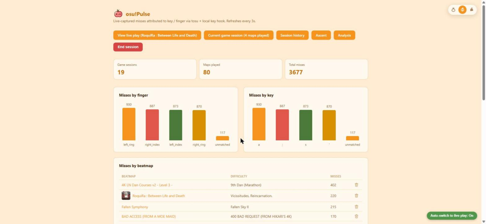
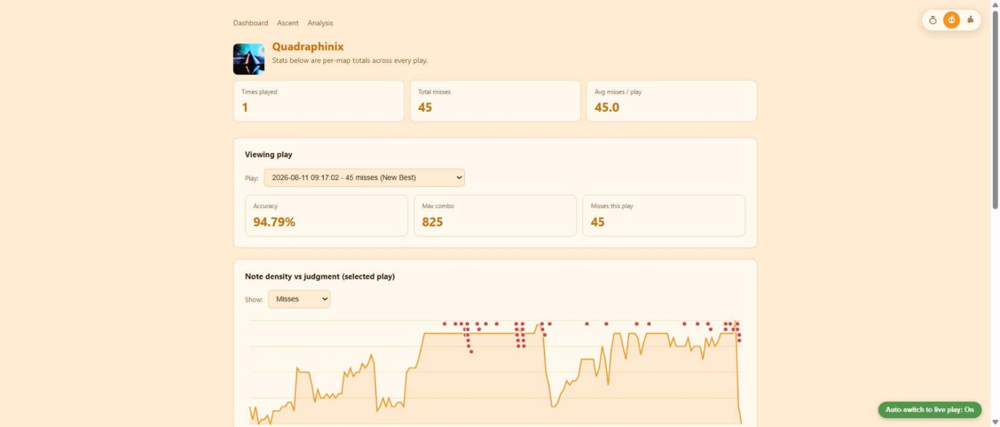
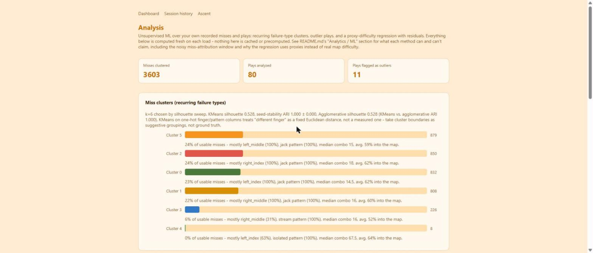
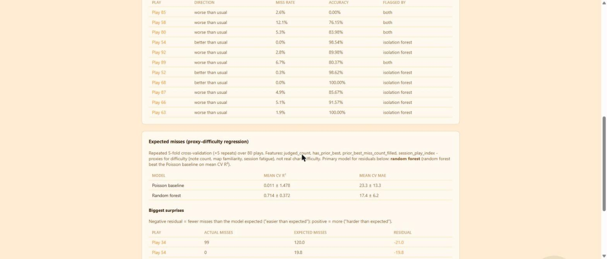
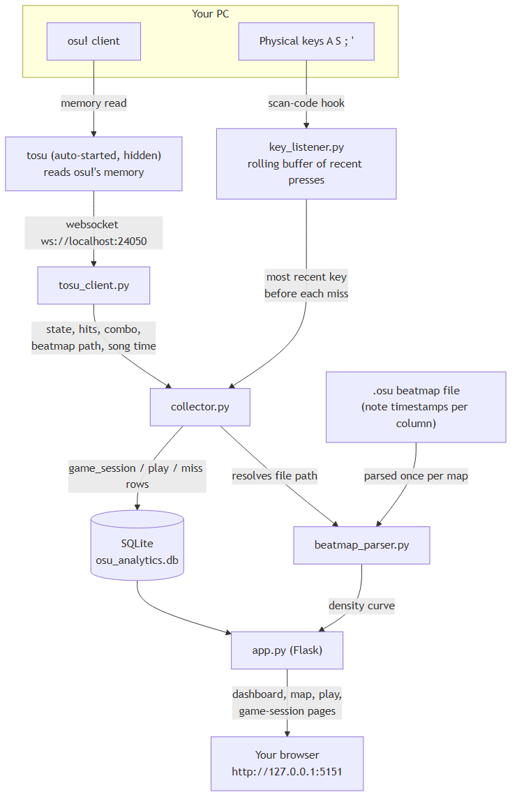

# osu!Pulse

Real-time osu!mania miss telemetry (key/finger attribution, note-pattern context) plus a small unsupervised-ML layer — clustering, anomaly detection, regression with residuals — for finding patterns in your own play.

## Overview

osu!Pulse watches osu!mania while you play, records every miss and judgment, and attributes each miss to the key/finger that most likely caused it by correlating tosu's live memory feed with a local keyboard hook. Everything is shown in a Flask dashboard: per-map density-vs-miss overlays, per-play breakdowns, per-session history, and — on top of all of that — an `/analysis` page that runs three ML methods over your own recorded history:

- **Clustering** recurring miss "failure types" (which finger, which note pattern, where in the map, what combo)
- **Anomaly detection** for plays that were unusually bad or unusually good given the rest of your history
- **Regression** modelling expected misses from available covariates, with residuals showing where a play went better or worse than expected

This project exists as a small, honestly-evaluated prototype of mining gameplay telemetry for patterns using unsupervised methods — see [Limitations](#limitations) for exactly what it can and can't claim.

## Demo

**Dashboard home** — live totals, misses by finger/key, misses by beatmap:



**Map page** — note density vs. miss overlay for a single play:



**Analysis page** — miss clusters (recurring failure types):



**Analysis page** — outlier plays and regression residuals:



*(GIF of a live session — to be added)*

## How it works / Architecture

tosu (https://github.com/tosuapp/tosu) reads osu!'s live memory and exposes it over a local websocket — the only way to get miss/combo/beatmap data out of osu! at all, since the game itself exposes nothing to outside programs. But tosu has no idea which physical key you pressed. So this project layers a second signal on top: a global keyboard hook that timestamps your 4 mania keys, and correlates "a miss just happened" (from tosu) with "which tracked key was pressed most recently" (from the hook) to attribute each miss to a finger.



**Why a heuristic, not ground truth:** neither tosu nor osu! itself will tell an outside program "key X caused miss Y" — that mapping only exists inside the game's own hit-judgment code. The best available proxy is timing correlation: whichever tracked key was pressed most recently before the miss was reported, within `MISS_ATTRIBUTION_WINDOW` (`config.py`). This is accurate for isolated misses but noisier on dense jacks/chords where multiple notes miss within the same tosu update tick. This noise is also why every ML method below is described as *suggestive*, not authoritative.

**Data flow:** tosu websocket → `collector.py` (merges tosu state + key-hook timestamps, detects new misses/judgments/hit-errors, parses the current beatmap's `.osu` file for note density/pattern) → SQLite (`osu_analytics.db`, schema in `db.py`) → Flask (`app.py`) serves both the live dashboard pages and `src/analysis/`'s clustering/anomaly/regression reports, computed fresh from the database on each `/analysis` page load.

### What it tracks

| Level | What it is | Example |
|---|---|---|
| **Game session** | One continuous osu!-open-to-close run | "Tuesday night's 2-hour session" |
| **Play** | One attempt at one map, within a game session | "3rd attempt at Cryptarithm [MASTER]" |
| **Miss** | One missed note within a play | key, finger, song position, combo at the time, local note pattern |

## Setup

1. Fetch tosu into `vendor/tosu.exe`:
   ```powershell
   .\fetch_tosu.ps1
   ```
   (or download manually from https://github.com/tosuapp/tosu/releases and place `tosu.exe` in `vendor/`)
2. Your keybinds default to `A S ; '`. If that's not what you play with, change it either from the dashboard's "Key settings" panel once the app is running (takes effect immediately, no restart), or by editing `settings.json` directly. Must match your actual in-game keybinds (osu! Options > Input > osu!mania Bindings), and the order (left to right) must match your in-game column order.
3. Install dependencies:
   ```
   pip install -r requirements.txt
   ```

## Usage

**Running it:** double-click `START osu!Pulse.bat` in the project root. It requests Administrator automatically (see note below) and starts everything: tosu (hidden, if not already running), the collector (key hook + tosu listener), and the dashboard, opened in your browser at http://127.0.0.1:5151. Close its console window to stop the app.

(Equivalent manual command, if you'd rather run it yourself from an Administrator terminal: `python src/app.py` from the project root.)

**Administrator note:** the global keyboard hook needs the terminal (or the packaged exe) run as Administrator to reliably catch key presses while osu! — a focused game window — has input focus. Without it, misses may log as "unmatched" (no key/finger).

**Pages:**
- **Dashboard** (`/`) — live totals, misses by finger/key, misses by beatmap with thumbnail art, collapsible recent-misses log, one-click jump to whatever's currently live.
- **Map page** (`/map/<id>`) — every attempt at a beatmap, note-density-vs-miss overlay combining all plays, miss trend across attempts, delete individual plays.
- **Play page** (`/play/<id>`) — live view of a single attempt, refreshing every 2s while in progress.
- **Game session page** (`/game-session/<id>`) — every map played in one sitting, in order, with miss counts per map.
- **Session history** (`/sessions`) — every recorded game session; export/import session data as JSON.
- **Analysis page** (`/analysis`) — miss clusters, outlier plays, regression residuals (see below).

**Running tests:**
```
pytest
```
Tests for `src/analysis/` run entirely against a synthetic data generator (`src/analysis/synth.py`, clearly marked test-only), so they pass identically regardless of how much real play history exists locally.

## Analytics / ML methods

### Miss clustering — recurring failure types

KMeans over standardised features (finger and note-pattern one-hot columns, log-scaled combo-before-miss, and position-in-map) groups misses into clusters, each summarised in plain language (dominant finger, dominant pattern, typical combo, typical map position). *k* is chosen by sweeping silhouette score rather than fixed in advance, and reported alongside:
- **Stability** — the same *k* is re-fit at five different random seeds and compared pairwise with Adjusted Rand Index, showing how much the specific cluster assignment depends on where KMeans happened to start.
- **A second method** — Agglomerative clustering (no centroid assumption, no random seed) is fit at the same *k* as a sanity check, with its own silhouette score and an ARI comparison against KMeans's labels.

### Anomaly detection — outlier plays

Two independent methods flag plays that look unusually bad or unusually good given the rest of your history: an IsolationForest over `[miss_rate, accuracy, max_combo, failed]`, and a robust z-score baseline (median/MAD, not mean/stdev) on miss rate and accuracy alone. Both are reported side by side, with agreement/disagreement called out explicitly.

### Expected misses — proxy-difficulty regression

**Not a true map-difficulty regression.** A real one needs the map's actual note density, pattern mix, and difficulty settings — and for most of this project's historical plays, the `.osu` file those come from is no longer on disk (songs get deleted/moved between plays). The regression instead uses what's actually available for every play: `judged_count` (a note-count/length proxy), whether/how this map had already been played before (`prior_best_miss_count`, from osu!'s own local leaderboard), and `session_play_index` (a fatigue proxy). A Poisson GLM baseline (miss count is a non-negative count) is compared against a small RandomForest via repeated 5-fold cross-validation (×5 repeats). Whichever model wins on mean CV R² is used for residuals (`actual − expected`), surfaced as "harder/easier than expected." If the forest doesn't beat the baseline, the page says so plainly.

**Forward-looking fix:** the collector now saves real note density, jack/stream/isolated pattern mix, and CS/OD/AR/HP for every beatmap it successfully parses, to a `beatmap_stats` table that survives even after the `.osu` file is later deleted. Existing historical plays can't benefit retroactively, but future play data will support a real difficulty-based regression, not just the proxies above.

## Results

Example output from a real run of `/api/analysis` against this project's own local `osu_analytics.db` (76 recorded plays, 3,448 recorded misses, one player) — included here as a worked example of what each method actually produces, not as a general claim:

- **Clustering:** 3,338 of 3,448 misses were usable (110 unmatched to a key, excluded). Silhouette sweep selected k=6 (silhouette 0.526); KMeans vs. Agglomerative ARI was 1.000 (the two methods agreed completely on this data); seed-stability ARI was 1.000 ± 0.000. Four of the six clusters split almost entirely by finger within jack patterns (23–25% of misses each), one cluster (7%) was dominated by stream patterns, and one tiny cluster (7 misses) was isolated-pattern misses — i.e. on this dataset, clustering mostly rediscovered "which finger", because jacks vastly outnumber other pattern types in the underlying data.
- **Anomaly detection:** of 74 plays with complete data, 9 were flagged by at least one method (4 by both IsolationForest and the z-score baseline, 5 by IsolationForest only, 0 by the baseline only).
- **Regression:** over 76 plays (repeated 5-fold × 5-repeat CV), the Poisson baseline scored mean CV R² = 0.615 ± 0.191 (MAE 19.1 ± 8.2); the RandomForest scored R² = 0.618 ± 0.192 (MAE 18.7 ± 6.2) — a negligible edge for the forest, reported as such rather than oversold.

## Limitations

- **Miss attribution is a timing heuristic, not ground truth** — see "Why a heuristic, not ground truth" above. Unmatched misses (no key within the attribution window) are excluded from clustering rather than guessed.
- **The regression is a proxy-difficulty model**, not a true difficulty regression, for the reasons above — most historical plays have no surviving `.osu` file to compute real difficulty features from.
- **Small N throughout.** Double digits of plays and a few thousand misses from one player is enough to demonstrate the methods honestly (real CV, real stability checks) but not enough to generalize — every result above is reported as a single-player example, not a validated model.
- **KMeans on one-hot categorical features** treats "different finger" as a fixed Euclidean distance, a modelling convenience rather than a measured quantity — cluster boundaries should be read as suggestive groupings, not ground truth. The Agglomerative comparison exists specifically to check this.
- **This is not a cheat/exploit detector** and makes no claim to be production-grade; it's a working prototype of the method (cluster → flag outliers → regress residuals) applied honestly to one real dataset.

## Project structure

```
osu-analytics/
├── src/
│   ├── app.py              Flask app: routes, API, entry point
│   ├── collector.py        Ties tosu + the key hook together, detects misses
│   ├── tosu_client.py      Websocket client for tosu's live data feed
│   ├── tosu_launcher.py    Auto-starts tosu hidden if it isn't already running
│   ├── key_listener.py     Global keyboard hook (scan-code based)
│   ├── beatmap_parser.py   Reads .osu files for note density/pattern/difficulty
│   ├── db.py                SQLite schema + queries
│   ├── settings.py          Loads/saves the key-to-finger mapping (settings.json)
│   ├── config.py            Tunables (tosu URL, miss attribution window, ports)
│   ├── progress.py          PP/rank forecast ("Ascent" page)
│   ├── analysis/            Clustering / anomaly detection / regression (ML layer)
│   │   ├── features.py      Tidy miss-level & play-level DataFrames from the DB
│   │   ├── clustering.py    KMeans + Agglomerative miss clustering
│   │   ├── anomaly.py       IsolationForest + robust z-score outlier plays
│   │   ├── regression.py    Poisson baseline + RandomForest miss-count regression
│   │   ├── report.py        Glues features.py into the three methods for the API
│   │   └── synth.py         Synthetic data generator for tests only
│   ├── templates/           Dashboard, map, play, session, analysis pages
│   └── static/              CSS + chart rendering JS
├── tests/                   Unit tests for src/analysis/ (synthetic data only)
├── docs/                    architecture.mmd / architecture.png
├── vendor/                  tosu.exe lands here (fetched, not committed)
├── dist/                    PyInstaller output (.exe) lands here — outside src/
├── fetch_tosu.ps1           Downloads tosu's latest Windows release into vendor/
├── requirements.txt
├── LICENSE                  This project's own code (MIT)
├── THIRD_PARTY_NOTICES.md
├── THIRD_PARTY_LICENSES/    Full third-party license texts (e.g. tosu's LGPL-3.0)
├── osu_analytics.db         Created automatically at the project root (gitignored)
└── settings.json             Key-to-finger mapping — created automatically (gitignored)
```

## Tech stack

- **Python 3.11**, **Flask** (dashboard + API)
- **scikit-learn** (KMeans, AgglomerativeClustering, IsolationForest, RandomForestRegressor, PoissonRegressor) + **pandas** / **numpy** for the analysis layer
- **SQLite** for storage, raw `sqlite3` (no ORM)
- **websockets** client for tosu's live feed; a scan-code-based global keyboard hook (`keyboard`) for key attribution
- **pytest** for tests; **PyInstaller** for the standalone `.exe` build
- Vanilla JS + hand-rolled SVG/DOM charts for the dashboard (no frontend framework/build step)

## Packaging into a standalone .exe

Once everything works via `python src/app.py`:

1. Make sure `vendor/tosu.exe` is present (`.\fetch_tosu.ps1` if not).
2. From the project root, build with PyInstaller:
   ```
   pyinstaller --onefile --name osu-pulse ^
     --add-data "src/templates;templates" ^
     --add-data "src/static;static" ^
     --add-binary "vendor/tosu.exe;." ^
     --add-data "THIRD_PARTY_NOTICES.md;." ^
     --add-data "THIRD_PARTY_LICENSES;THIRD_PARTY_LICENSES" ^
     --icon "src/static/mascot.ico" ^
     src/app.py
   ```

The resulting `dist/osu-pulse.exe` bundles Python, all dependencies, and tosu itself — outside `src/`. Users just run it (as Administrator, for the key hook) — no separate tosu install needed, no Python install needed. The `--add-data` flags above also ship `THIRD_PARTY_NOTICES.md` and tosu's bundled LGPL-3.0 license text next to the exe, so the license terms travel with the binary, not just the source repo.

## License

This project's own code is **MIT-licensed** (see `LICENSE`).

It bundles and auto-launches **tosu** (https://github.com/tosuapp/tosu) as a
separate, unmodified binary for convenience — tosu is **not** covered by
this project's MIT license and remains under its own **LGPL-3.0** terms.
Full attribution and the bundled license text are in
`THIRD_PARTY_NOTICES.md` and `THIRD_PARTY_LICENSES/tosu-LGPL-3.0.txt`.
